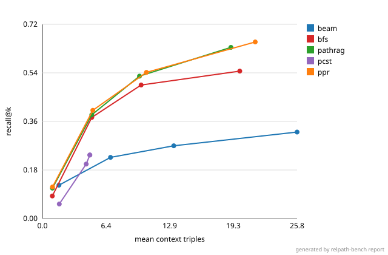
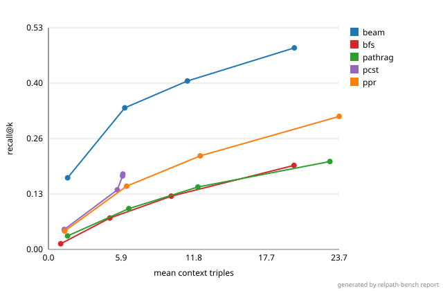

# relpath-bench

A small benchmark that compares relational path retrieval algorithms on knowledge graphs under one harness, one budget and one set of scoring rules.

## Results

<!-- RESULTS:START -->
### metaqa (test-full)

reachable_ratio by hops (answer within 3 hops of a seed): 1-hop 99.98%, 2-hop 100.00%, 3-hop 100.00%

| algorithm | hops | hit@1 | hit@10 | recall@10 | context@10 | p50 ms | capped |
| --- | --- | --- | --- | --- | --- | --- | --- |
| beam | 1 | 40.7% | 52.3% | 51.2% | 14.1 | 68.3 | 8 |
| beam | 2 | 12.6% | 28.3% | 25.3% | 12.3 | 46.0 | 2 |
| beam | 3 | 12.1% | 26.1% | 12.2% | 13.9 | 93.5 | 5 |
| bfs | 1 | 40.3% | 97.8% | 95.8% | 10.0 | 21.6 | 0 |
| bfs | 2 | 0.0% | 64.3% | 54.5% | 10.0 | 10.8 | 0 |
| bfs | 3 | 6.2% | 43.6% | 12.6% | 10.0 | 34.5 | 0 |
| pathrag | 1 | 47.7% | 90.8% | 87.7% | 9.7 | 2.2 | 0 |
| pathrag | 2 | 0.3% | 81.3% | 65.5% | 9.7 | 2.9 | 0 |
| pathrag | 3 | 13.6% | 44.6% | 15.8% | 10.0 | 2.3 | 0 |
| pcst | 1 | 22.9% | 63.1% | 50.2% | 5.2 | 216.3 | 0 |
| pcst | 2 | 3.3% | 42.8% | 22.5% | 5.2 | 52.4 | 0 |
| pcst | 3 | 7.6% | 19.3% | 6.4% | 4.0 | 180.9 | 0 |
| ppr | 1 | 47.2% | 98.1% | 95.4% | 10.7 | 62.8 | 0 |
| ppr | 2 | 0.7% | 75.8% | 61.9% | 10.2 | 57.2 | 0 |
| ppr | 3 | 18.5% | 50.8% | 18.1% | 10.7 | 74.9 | 0 |



### webqsp (test-full)

reachable_ratio (answer within 3 hops of a seed): beam 95.3%, bfs 95.3%, pathrag 95.3%, pcst 95.3%, ppr 95.3%

Subset `all`

| algorithm | hops | hit@1 | hit@10 | recall@10 | context@10 | p50 ms | capped |
| --- | --- | --- | --- | --- | --- | --- | --- |
| beam | all | 26.7% | 46.5% | 40.1% | 11.3 | 25.0 | 0 |
| bfs | all | 3.6% | 19.7% | 12.7% | 10.0 | 4.0 | 0 |
| pathrag | all | 6.3% | 24.1% | 14.9% | 12.2 | 1.6 | 0 |
| pcst | all | 8.1% | 29.2% | 17.5% | 6.0 | 513.3 | 0 |
| ppr | all | 8.4% | 33.8% | 22.3% | 12.4 | 6.9 | 0 |

Subset `reachable`

| algorithm | hops | hit@1 | hit@10 | recall@10 | context@10 | p50 ms | capped |
| --- | --- | --- | --- | --- | --- | --- | --- |
| beam | all | 28.0% | 48.8% | 42.1% | 11.3 | 25.0 | 0 |
| bfs | all | 3.8% | 20.6% | 13.3% | 10.0 | 4.0 | 0 |
| pathrag | all | 6.6% | 25.3% | 15.6% | 12.2 | 1.6 | 0 |
| pcst | all | 8.5% | 30.6% | 18.4% | 6.1 | 513.5 | 0 |
| ppr | all | 8.8% | 35.4% | 23.4% | 12.4 | 6.9 | 0 |

- answer names dropped (not nodes of the subgraph): 7,113
- questions with no answer left: 71 of 1,628 (counted as misses in `all`)
- recall is computed over answers present in the graph


<!-- RESULTS:END -->

## Install

```bash
pip install -e '.[embed,metaqa]'  # run from a clone of this repository; not on PyPI
```

## Quickstart

```bash
relpath-bench list                                   # registered algorithms
relpath-bench run --dataset metaqa                   # 1,000-question sample per hop count, seed 0
relpath-bench run --dataset metaqa --full            # every question
relpath-bench run --dataset webqsp --full            # every question; add --workers 4 to parallelise
relpath-bench report --out results --readme README.md
```

The README tables are built from `--full` runs only. Sample runs are for quick checks.

## Algorithms

| Name | Paper | Reads question | Differences from the paper |
| --- | --- | --- | --- |
| bfs | none (baseline) | no | Breadth-first search; every reached node yields its shortest path. |
| ppr | HippoRAG, [arXiv:2405.14831](https://arxiv.org/abs/2405.14831) | no | Personalized PageRank only; nodes inside the hop limit become paths along their BFS-tree path. |
| pathrag | PathRAG, [arXiv:2502.14902](https://arxiv.org/abs/2502.14902) | no | One flow per query seed instead of paths between retrieved node pairs; every node holding resource yields its propagation-tree path. No keyword-based node retrieval, and the question is ignored. |
| beam | Think-on-Graph, [arXiv:2307.07697](https://arxiv.org/abs/2307.07697) | yes | Relation selection uses embedding similarity between question and relation name instead of an LLM. The top `width` relations are kept per hop and every edge with a kept relation is followed, so there is no entity pruning (the frontier is bounded by relation count, not by `width`) and no LLM stopping rule. |
| pcst | G-Retriever, [arXiv:2402.07630](https://arxiv.org/abs/2402.07630) | yes | Retrieval step only, no GNN and no LLM. Prizes sit on nodes (the most question-similar nodes); relation similarity only lowers edge cost, which approximates the paper's edge prizes. Seeds get a forced prize, which the paper does not have. The subgraph is the 3-hop BFS ball around the seeds, not the full dataset subgraph. |

The question-aware methods (beam, pcst) embed text with `sentence-transformers/all-MiniLM-L6-v2`; their numbers depend on that model. The question-blind methods (bfs, ppr, pathrag) return the same paths for any question with the same seeds, which is a likely reason beam leads on WebQSP (not isolated by an ablation). Tuning settings and results are in [docs/tuning.md](docs/tuning.md).

The PathRAG implementation was written from the paper and does not use code from the original repository.

## Fairness rules

- Every algorithm starts from the same seeds, the topic entities given by the dataset.
- Budgets are k in {1, 5, 10, 20}; a retriever records its top 20 paths.
- Ties are broken by the harness: score descending, then path length ascending, then node id tuple (sorted node names, so the last tie-break is alphabetical).
- An answer counts only when it is the end node of a path. Zero-length paths are dropped from the ranking.
- Paths have at most 3 hops.
- At most 10,000 node scans per query (beam counts one per frontier path); hitting the cap is reported in the `capped` column.
- Recall is computed over the answers that are nodes of the graph. WebQSP answer names missing from the subgraph are dropped; the counts are listed under the WebQSP results.
- Hyperparameters are tuned on the validation split only. Defaults and sources are in each retriever's module docstring.

## Measurement conditions

Latencies (`p50 ms`) were measured on an Apple Silicon laptop (Apple M2, 8 CPU cores) with 4 to 6 worker processes (`--workers`; the MetaQA run was resumed with 4 after a failure at 6, the WebQSP run used 4). Each worker keeps its own embedding cache, so beam and pcst latency excludes repeated embedding of the same text and depends on the order in which questions reach a worker. Absolute values vary with hardware; compare them across algorithms within one table.

## Datasets

| Dataset | Source | License |
| --- | --- | --- |
| MetaQA | [yuyuz/MetaQA](https://github.com/yuyuz/MetaQA) | Creative Commons, per its README |
| WebQSP | Hugging Face `rmanluo/RoG-webqsp` | The dataset card states no license |

The WebQSP download is pinned at revision `c0632533135a06f8c5d536b420deec5fcb5c58f3`. Both are downloaded on demand and are not redistributed here. The original MetaQA Google Drive folder returned HTTP 401 on 2026-11-24, so the loader falls back to the Hugging Face dataset `camazlucas/MetaQA` pinned at revision `f83854092893610686ab19f2038c039afa9bc643` (it ships `kb/kb.txt` instead of `kb.txt`). Its `kb.txt` has the same SHA-256 (`9b4d3b3066266075ad1577b4beed68e6e112e76e1a29ed2cb00a2896d2b792af`) as the `kb.txt` in the independent copy [brandenkang/MetaQA_PBG](https://github.com/brandenkang/MetaQA_PBG). The question files were checked by line count against the original README table only; they were not byte-compared with the original.

## Adding an algorithm

Add one file under `src/relpath_bench/retrievers/`, decorate the class with `@register`, give it a `name` and a `needs_embedder` flag, and implement `retrieve(g, q, k, limits)`. Import it in `retrievers/__init__.py`; `relpath-bench list` then shows it and `report` requires its results.

## License

Apache-2.0
